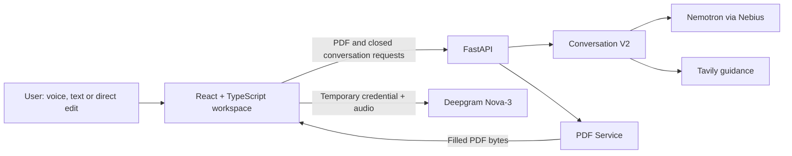

# Formless

> A voice-first AI assistant that helps people understand and complete confusing
> fillable PDF forms.

Formless behaves like a patient helper sitting beside the user. It explains
official wording, asks one question at a time, listens to answers in ordinary
language, and prepares values for the form. Every AI-proposed value remains
reviewable and must be confirmed before it changes the PDF.

> **Prototype status:** Formless is a hackathon prototype for supported
> fillable AcroForm PDFs. It is not a legal-advice service. Use synthetic
> information when evaluating the public project.

## The problem

Official forms often assume that people understand bureaucratic language, know
how their information maps to particular boxes, and can manage a long sequence
of questions without help. This can be especially difficult for people facing
an unfamiliar bureaucracy, limited English, dyslexia, ADHD, low confidence,
physical access needs, or the stress of a high-stakes application.

A human helper would explain an unfamiliar phrase, listen to the answer, ask a
follow-up question when necessary, and check the result before writing it down.
Formless explores how an AI assistant can provide that kind of support while
keeping the user in control of every factual answer.

## What Formless does

- Extracts text fields, dropdowns, checkboxes and available options from a
  fillable PDF.
- Displays the document in a custom page-by-page PDF workspace.
- Guides the user through the form by voice or text.
- Uses NVIDIA Nemotron through Nebius Token Factory to explain questions and
  interpret natural-language answers.
- Uses Deepgram Nova-3 for streaming speech recognition and hands-free turns.
- Can request bounded live guidance through Tavily when the user asks for it.
- Shows the original answer and prepared value for review before applying it.
- Keeps AI conversation logic separate from PDF extraction and filling.
- Supports direct PDF-field editing and a manual editor as reliable fallbacks.
- Generates a new completed PDF without overwriting the uploaded file.

## Demo flow

1. Upload a supported fillable PDF.
2. Start the guided conversation and answer by voice or text.
3. Ask Formless to explain or simplify a confusing question.
4. Review the structured field value prepared from the user's answer.
5. Confirm, edit, reject or skip the proposal. Unconfirmed AI output never
   changes the form.
6. Watch confirmed answers update the PDF preview, or click a PDF field to edit
   it directly.
7. Review completed and unanswered fields, then download the filled PDF.

Typing and direct editing remain available if voice or an external provider is
unavailable.

## Architecture



The frontend owns the ephemeral conversation, review UI and canonical field
state. FastAPI exposes the application boundary and validates closed effects.
The conversation service may explain, interpret and propose, but it cannot edit
PDF bytes or silently change confirmed form state. Only confirmed values reach
the independent PDF service.

### Technology stack

| Area | Technology |
| --- | --- |
| Frontend | React, TypeScript, Vite, PDF.js |
| Backend | Python, FastAPI, Pydantic |
| AI | NVIDIA Nemotron through Nebius Token Factory |
| Speech recognition | Deepgram Nova-3 streaming |
| Optional web guidance | Tavily Search API |
| PDF processing | pypdf and PyMuPDF |
| Testing | pytest and focused Node.js workflow checks |

## Safety model

- The user is the source of personal facts.
- Model output is limited to a small set of typed effects.
- Field IDs, primitive types and finite-choice options are validated by code.
- A proposal never changes canonical form state.
- Confirmation is required before an AI-proposed value reaches the PDF.
- Replacing a confirmed answer also requires review and confirmation.
- PDF manipulation remains independent from AI and voice services.
- Typed and manual editing remain available during provider failures.

## Supported scope

Formless currently supports tested AcroForm PDFs with text, dropdown and
checkbox fields. The repository includes synthetic fixtures and compatibility
coverage for more complex real-world AcroForms.

The current prototype does not promise universal PDF support. In particular,
it does not provide OCR for flat scanned documents, XFA-form execution,
electronic signatures, authentication, account storage or long-term document
persistence. AI interpretation and speech recognition can still be wrong, so
the visible review boundary and manual fallback are essential parts of the
product.

## Run locally

### Prerequisites

- Python 3.9 or newer
- Node.js `^20.19.0` or `>=22.12.0`
- A modern browser; microphone access requires `localhost` or HTTPS

### 1. Start the backend

From the repository root on macOS or Linux:

```bash
cd backend
python3 -m venv .venv
source .venv/bin/activate
pip install -r requirements-dev.txt
cp .env.example .env
```

Run the `cp` command only when creating `backend/.env` for the first time. Add
the server-side credentials needed for the features you want to use:

| Variable | Enables |
| --- | --- |
| `NEBIUS_API_KEY` | Nemotron explanations and guided conversation |
| `DEEPGRAM_API_KEY` | Streaming voice recognition |
| `TAVILY_API_KEY` | Optional live form guidance |

Never commit `backend/.env` or place these values in a `VITE_` variable.

Load the environment and start FastAPI:

```bash
set -a
source .env
set +a
uvicorn app.main:app --reload
```

The API runs at `http://127.0.0.1:8000`. Check it with:

```bash
curl http://127.0.0.1:8000/health
```

### 2. Start the frontend

In a second terminal from the repository root:

```bash
cd frontend
npm install
npm run dev
```

Open `http://localhost:5173` and upload a supported fillable PDF. PDF upload,
manual editing, filling and download remain available without external-provider
credentials.

## Tests and evaluation

Run the backend regression suite:

```bash
cd backend
source .venv/bin/activate
python -m pytest -q
```

Run the focused frontend checks and production build:

```bash
cd frontend
npm run test:pdf-workflow
npm run test:workspace-layout
npm run test:voice-audio-capture
npm run test:voice-interruption
npm run test:deepgram-speech
npm run test:continuous-voice
npm run build
```

The evaluation harness replays synthetic multi-turn interviews through the
same conversation boundary used by the application. With the provider
credentials loaded, run the V2 human-helper suite with:

```bash
cd backend
source .venv/bin/activate
set -a
source .env
set +a
python -m evaluations.conversation_harness run \
  --engine v2 \
  --label portfolio-review \
  --scenarios evaluations/scenarios/human_helper_experience_v2.json \
  --judge
```

Generated reports use synthetic information, contain no credentials and are
written under the ignored `backend/evaluations/results/` directory. The harness
combines deterministic form-state checks with qualitative conversation scores;
natural wording cannot compensate for an incorrect canonical state.

## Engineering highlights

- A closed-effect conversation architecture prevents the model from writing
  directly to form state or PDF bytes.
- A canonical field model keeps voice, typing, direct PDF edits and the manual
  editor synchronized.
- The voice pipeline uses temporary browser credentials, raw 16 kHz PCM,
  bounded pre-roll and conservative interruption detection.
- PDF filling creates new bytes and preserves the uploaded source document.
- Versioned transcript scenarios measure context retention, clarification,
  repetition, recovery, invention and exact final form state.
- Provider failures preserve user state and leave non-AI workflows available.

Detailed implementation history and acceptance evidence live in
[`PROJECT_PLAN.md`](PROJECT_PLAN.md), [`ARCHITECTURE.md`](ARCHITECTURE.md),
[`DECISIONS.md`](DECISIONS.md) and [`docs/`](docs/).

## Repository structure

```text
frontend/                 React application and focused browser checks
backend/app/              FastAPI routes and production services
backend/app/services/     Conversation, PDF, Nemotron, Tavily and Deepgram code
backend/tests/            Backend regression tests and PDF fixtures
backend/evaluations/      Synthetic conversation scenarios and evaluation tools
docs/                     Milestone evidence and design references
```

## Privacy and limitations

Formless does not implement accounts or database persistence. Conversation and
form state are held in the browser for the active session. External AI, search
and speech providers receive only the bounded data needed for their feature.
Do not use the public prototype with real sensitive or high-stakes information.

The current build is intended to demonstrate the product direction and
engineering approach. It should not be relied on to determine eligibility,
provide legal or financial advice, or submit a form without human review.

## License

Formless is open-source software licensed under the [MIT License](LICENSE).
